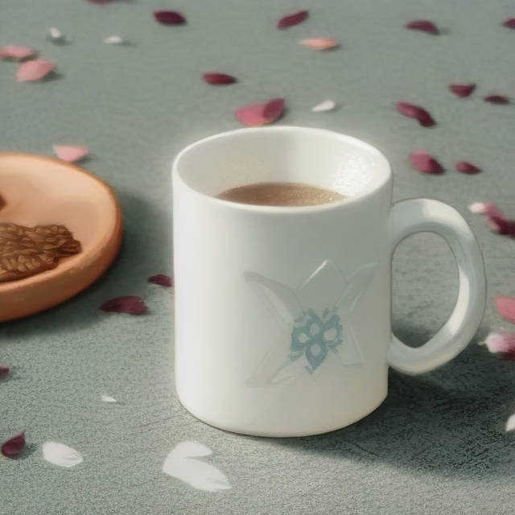

# Research results, provenance and limitations

[中文](results.md) · [English](results.en.md) · [Research overview](overview.en.md) · [Home](../../README.en.md)

## Historical gallery, not a new experiment

Originals come from a [pinned Endless-XXX commit](https://github.com/ZerothXX/Endless-XXX/tree/6bd78d48c4c99bef0be3ecf4f71e8536349c2acb). They were copied byte for byte on 2026-10-26, without regeneration, editing or claims of a new quality improvement. The research README names March 7th as the test character and describes inputs as sourced from the internet. Individual authors and licenses are not recorded; this is not a new license grant.

| Subject | Input | Historical output |
|---|---|---|
| Person |  |  |
| Animal |  |  |
| Object |  |  |

These examples illustrate the research direction, not a statistical open-domain evaluation. Faces, clothing, hands, accessories and non-human structure need separate review; pink/blue colors alone do not establish successful transfer. Other historical examples remain upstream. These three selected pairs are neither a complete nor a random sample.

## Research web interface

This is the research repository's interface, **not Endlexx's UI**. Application character management, chats, RAG and orchestration are separate; showing research training does not implement training inside Endlexx.

## Known failures and acceptance boundaries

| Source | Known issue | Interpretation |
|---|---|---|
| Historical research notes | Animals and objects need improvement; people fare relatively better | Qualitative observation, not a uniform benchmark or success rate |
| Actual Endlexx transfer acceptance | Visible banding and edge artifacts; about 13 minutes for one example | Execution succeeded but image quality failed; separate from this gallery |
| Endlexx consistency judgment | Missing glasses can still be reported as unknown | Unsuitable as an automatic final quality decision |
| LoRA diagnostics | Fixed references are still training data | Loss or best-checkpoint selection does not establish generalization or visual quality |

Application evidence and agent-planning evaluation are documented in the [quality report](../Agent质量与改进验收.md) and [release verification](../RELEASE.md). This documentation update did not rerun model training/inference or produce new quality scores.

## Reproduction records and gaps

The [asset manifest](../media/research/manifest.json) records each local file, upstream path, pinned URL, Git blob SHA1, SHA256 and byte count. Blob identifiers were checked against GitHub's tree; packaging rechecks SHA256.

The **actual seeds, complete effective settings and checkpoint hashes are unknown** for these historical images and remain `null` in the manifest. Current defaults or published LoRA weights cannot be substituted for their original generation records. Traceable images do not establish exact experimental reproducibility.

Future runs should record input/reference provenance and permissions, character cards and trigger words, code commits, effective settings, all model/LoRA hashes, seeds, resolution, sampler, steps, strengths, hardware, duration, failure examples and human scoring criteria. Compare best/final and policies with identical inputs and fixed seeds; preserve failures rather than showing only the best image.
